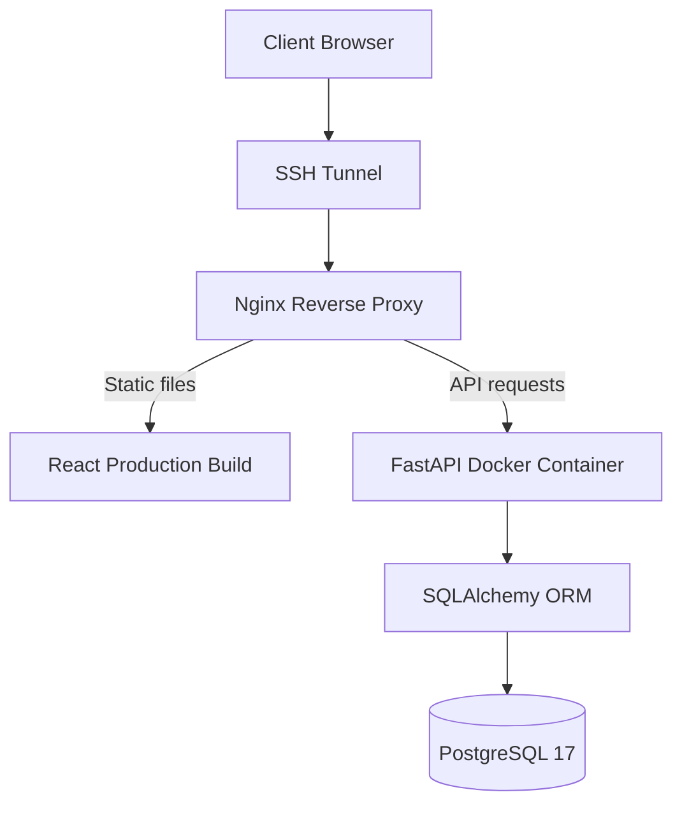
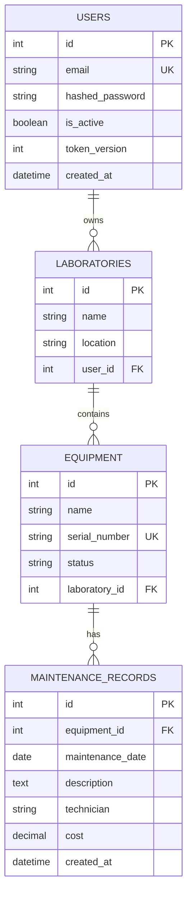

# LabManager

[](https://github.com/ozdereomer/LabManager/actions/workflows/ci.yml)


## Overview

LabManager is a full-stack laboratory and equipment management
application designed to simplify laboratory operations, equipment
inventory management, maintenance tracking, and reporting.

The application combines a FastAPI REST API, a React frontend,
PostgreSQL persistence, JWT authentication, automated testing,
containerized backend deployment, and an Nginx reverse proxy.

## Features

### Authentication and Account Management

- User registration and login
- JWT-based authentication
- Argon2 password hashing
- User-specific data isolation
- Account profile management
- Email and password updates
- Token invalidation after credential changes
- Centralized frontend session expiration handling
- Protected frontend routes

### Laboratory Management

- Create, list, update, and delete laboratories
- Manage laboratory names and locations
- View equipment assigned to each laboratory
- Prevent deletion of laboratories containing equipment
- Restrict access to user-owned laboratories

### Equipment Management

- Full equipment CRUD operations
- Unique serial number validation
- Equipment status tracking:
  - Available
  - Maintenance
  - Broken
- Filtering by name, serial number, status, and laboratory
- Sorting and pagination
- Equipment statistics
- User-specific equipment access control

### Maintenance Management

- Create, view, update, and delete maintenance records
- Track maintenance dates and descriptions
- Record technician information
- Track maintenance costs
- View equipment maintenance history
- Prevent deletion of equipment with maintenance records

### Dashboard

- Laboratory and equipment statistics
- Equipment status overview
- Total maintenance records
- Total maintenance costs
- Laboratory equipment distribution
- Recent maintenance activity

## Technology Stack

| Layer | Technologies |
|---|---|
| Backend | Python 3.12, FastAPI, Uvicorn |
| Frontend | React, Vite, React Router, Axios |
| Database | PostgreSQL 17 |
| ORM | SQLAlchemy |
| Validation | Pydantic |
| Migrations | Alembic |
| Authentication | JWT, PyJWT, Argon2 |
| Backend Testing | pytest, pytest-cov |
| Frontend Testing | Vitest, React Testing Library |
| Code Quality | ESLint |
| Containerization | Docker, Docker Compose |
| Web Server | Nginx |
| CI | GitHub Actions |
| Deployment | Bash, rsync, flock |
| Operating System | Ubuntu Server |

## System Architecture



Nginx serves the compiled React application and forwards requests
under `/api/` to the FastAPI backend.

The frontend and backend share the same browser origin.

The current server deployment binds Nginx and the backend API
to localhost. Remote access is provided through an SSH tunnel.

The Vite development server is not required in production.

## Database Relationships



## Project Structure

```text
LabManager/
├── .github/
│   └── workflows/
│       └── ci.yml
├── app/
│   ├── main.py
│   ├── auth.py
│   ├── security.py
│   ├── database.py
│   ├── models.py
│   └── schemas/
├── frontend/
│   ├── src/
│   │   ├── components/
│   │   ├── pages/
│   │   ├── services/
│   │   ├── tests/
│   │   └── utils/
│   ├── package.json
│   ├── package-lock.json
│   └── vite.config.js
├── deploy/
│   ├── nginx/
│   │   └── labmanager.conf
│   └── scripts/
│       └── deploy-frontend.sh
├── migrations/
│   └── versions/
├── tests/
├── .dockerignore
├── .gitignore
├── Dockerfile
├── compose.yaml
├── alembic.ini
├── pytest.ini
├── requirements.txt
├── requirements-dev.txt
└── README.md
```

## API Endpoints

All endpoints below are relative to the backend API root.
When accessing the application through Nginx, use the `/api`
prefix.

### General

| Method | Endpoint | Description |
|---|---|---|
| GET | `/` | API information |
| GET | `/health` | Application health check |

### Authentication

| Method | Endpoint | Description |
|---|---|---|
| POST | `/register` | Register a user |
| POST | `/login` | Authenticate and receive an access token |

### Account Management

| Method | Endpoint | Description |
|---|---|---|
| GET | `/users/me` | Retrieve account information |
| PUT | `/users/me/email` | Update email address |
| PUT | `/users/me/password` | Update password |

### Laboratories

| Method | Endpoint | Description |
|---|---|---|
| GET | `/laboratories` | List owned laboratories |
| POST | `/laboratories` | Create a laboratory |
| PUT | `/laboratories/{id}` | Update a laboratory |
| DELETE | `/laboratories/{id}` | Delete a laboratory |
| GET | `/laboratories/{id}/equipment` | List laboratory equipment |

### Equipment

| Method | Endpoint | Description |
|---|---|---|
| GET | `/equipment` | List and filter equipment |
| POST | `/equipment` | Create equipment |
| PUT | `/equipment/{id}` | Update equipment |
| DELETE | `/equipment/{id}` | Delete equipment |
| GET | `/equipment/stats` | Retrieve equipment statistics |

### Maintenance

| Method | Endpoint | Description |
|---|---|---|
| GET | `/maintenance` | List maintenance records |
| POST | `/maintenance` | Create a maintenance record |
| PUT | `/maintenance/{id}` | Update a maintenance record |
| DELETE | `/maintenance/{id}` | Delete a maintenance record |

### Dashboard

| Method | Endpoint | Description |
|---|---|---|
| GET | `/dashboard` | Retrieve dashboard statistics |

### Filtering and Pagination

The equipment endpoint supports the following query parameters:

- `name`
- `serial_number`
- `status`
- `laboratory_id`
- `sort_by`
- `order`
- `skip`
- `limit`

Example:

```http
GET /equipment?status=available&sort_by=name&order=asc&skip=0&limit=10
```

## Installation

### Prerequisites

- Git
- Docker Engine
- Docker Compose v2
- Node.js 24
- npm
- PostgreSQL 17
- Nginx for production frontend hosting
- rsync and flock for frontend deployment

### Clone the Repository

```bash
git clone https://github.com/ozdereomer/LabManager.git
cd LabManager
```

### Environment Variables

Create a `.env` file in the project root:

```env
POSTGRES_PASSWORD=replace_with_database_password
JWT_SECRET_KEY=replace_with_secure_random_secret
```

Generate a secure JWT signing secret locally:

```bash
openssl rand -hex 32
```

Use the generated value in the `.env` file.

Never commit real credentials, signing keys, or access tokens
to the repository.

The database password must match the password configured for
the PostgreSQL application user. With the current Compose URL
format, use a URL-safe password or correctly encode reserved
characters.

### PostgreSQL Configuration

The current Docker Compose configuration requires an existing
PostgreSQL instance with the following settings:

| Setting | Value |
|---|---|
| Hostname | `postgres-db` |
| Port | `5432` |
| Database | `labmanager` |
| Database user | `labmanager_user` |
| Docker network | `postgres-db_default` |

Provision the database, application user, and external Docker
network before starting the backend.

The PostgreSQL container is managed separately from this
repository's Compose services.

### Start the Backend

```bash
sudo docker compose up -d --build api
```

Check container status:

```bash
sudo docker compose ps
```

Apply database migrations:

```bash
sudo docker compose exec api python -m alembic upgrade head
```

Check application health:

```bash
curl -fsS http://127.0.0.1:8001/health
```

Expected response:

```json
{"status":"healthy"}
```

The health endpoint confirms application responsiveness.
It is not a comprehensive database readiness check.

### Frontend Development

```bash
cd frontend
npm ci
npm run dev
```

The development server uses port `3002` and proxies `/api`
requests to the backend.

### API Documentation

FastAPI provides interactive API documentation:

- Swagger UI: `http://127.0.0.1:8001/docs`
- ReDoc: `http://127.0.0.1:8001/redoc`
- OpenAPI: `http://127.0.0.1:8001/openapi.json`

For remote development, forward the backend port through SSH:

```bash
ssh -N -L 127.0.0.1:8001:127.0.0.1:8001 user@server-ip
```

Swagger and ReDoc should currently be accessed through the
direct backend tunnel rather than the Nginx API prefix.

## Automated Testing

### Latest Verified Test Results

| Test suite | Passing tests | Measured coverage |
|---|---:|---:|
| Backend | 122 | 100% |
| Frontend | 175 | 100% |
| Total | 297 | |

These results describe the latest verified local test runs.

Coverage measures the configured application source files.
It does not guarantee the absence of defects.

### Backend Tests

The Dockerfile separates production and test image targets.

Build the dedicated test image:

```bash
sudo docker compose build api-test
```

Run the isolated backend test suite:

```bash
sudo docker compose run --rm --no-deps api-test
```

Backend tests use an in-memory SQLite database and a
test-only JWT secret. The test container has no network access.

Production database records are not used by this test suite.

The backend coverage threshold is configured at 100%.

### Frontend Tests

```bash
cd frontend
npm ci
npm run test:coverage
npm run lint
npm run build
```

The frontend coverage threshold is configured at 95% for
statements, branches, functions, and lines.

The latest verified frontend run achieved 100% across all
four configured coverage metrics.

### Test Scope

- Authentication and authorization
- JWT validation and expiration
- User data isolation
- Laboratory, equipment, and maintenance operations
- Account management
- Input validation and error handling
- Frontend components and forms
- API interceptors and session handling
- Protected routes
- Dashboard behavior

## Continuous Integration

GitHub Actions runs automated checks for pull requests and
pushes to the main branch.

### Backend Pipeline

- Install Python dependencies
- Check dependency consistency
- Execute backend tests
- Enforce coverage requirements

### Frontend Pipeline

- Install locked npm dependencies
- Execute frontend tests
- Enforce coverage requirements
- Run ESLint
- Build production assets

The current pipeline provides continuous integration.
Production deployment is manually initiated and is not
automatically triggered by GitHub Actions.

## Production Docker Configuration

The backend uses a multi-stage Dockerfile with separate
production and testing targets.

Production characteristics:

- Python slim base image
- Non-root application user
- Test dependencies excluded
- Test source files excluded
- Localhost-only published API port
- Automatic container restart policy
- External PostgreSQL network integration

The test image includes development dependencies and
uses an isolated test environment.

## Nginx Production Deployment

### Install Required Packages

On Ubuntu Server:

```bash
sudo apt update
sudo apt install -y nginx rsync util-linux
```

### Build the Frontend

```bash
cd frontend
npm ci
npm run test:coverage
npm run lint
npm run build
cd ..
```

### Publish Static Files

```bash
sudo mkdir -p /var/www/labmanager

sudo rsync -a \
    --chown=root:root \
    --chmod=D755,F644 \
    frontend/dist/ /var/www/labmanager/
```

### Install Nginx Configuration

```bash
sudo install -m 644 \
    deploy/nginx/labmanager.conf \
    /etc/nginx/sites-available/labmanager

sudo ln -s \
    /etc/nginx/sites-available/labmanager \
    /etc/nginx/sites-enabled/labmanager
```

On a dedicated server, disable the default Nginx site
if it is enabled and not needed:

```bash
sudo unlink /etc/nginx/sites-enabled/default
```

Validate the configuration and restart Nginx:

```bash
sudo nginx -t
sudo systemctl restart nginx
sudo systemctl enable nginx
```

A restart may be necessary when changing the listening
address from a wildcard address to localhost.

### Verify the Deployment

```bash
curl -I http://127.0.0.1/
curl -fsS http://127.0.0.1/api/health
curl -i http://127.0.0.1/api/equipment
```

Expected results:

- Frontend: HTTP 200
- API health: HTTP 200
- Unauthenticated equipment request: HTTP 401

### Remote Access

From the client machine:

```bash
ssh -N -o ExitOnForwardFailure=yes \
    -L 127.0.0.1:8080:127.0.0.1:80 \
    user@server-ip
```

Open:

```text
http://127.0.0.1:8080
```

The SSH tunnel encrypts network traffic between the client
and the server.

The current deployment does not expose Nginx directly
to the public internet.

## Automated Frontend Deployment

After the initial Nginx setup, update the frontend using:

```bash
./deploy/scripts/deploy-frontend.sh
```

Run the script as a regular user with sudo privileges.

The deployment script performs:

1. Environment validation
2. Dependency installation
3. Automated tests and lint checks
4. Production build
5. Backup of the previous frontend
6. Publication of new frontend assets
7. HTTP health and HTML content checks

### Deployment Safety

- Concurrent deployments are blocked using flock.
- Failed tests prevent publication.
- Existing frontend files are backed up.
- The new index.html is published after static assets.
- Previous hashed assets are retained.
- Publication or health-check command failures trigger
  a rollback attempt.

Backups are stored under:

```text
/var/backups/labmanager/frontend/
```

The successful deployment path, backup integrity,
concurrent deployment protection, and isolated rollback
function have been tested.

The deployment is not fully atomic and does not guarantee
recovery from power loss, process termination, or every
possible filesystem and permission failure.

Automatic backup and old asset retention policies are
planned improvements.

## Security

### Application Security

- Argon2 password hashing
- Signed JWT access tokens
- Access token expiration
- Token version validation
- Credential-change session invalidation
- User-specific resource authorization
- Input validation
- Sanitized validation error responses
- Generic internal server error responses
- Non-root backend container
- Environment-based secret configuration

### Nginx Security

- Localhost-only listener
- Hidden Nginx version
- Content-Security-Policy
- X-Content-Type-Options
- X-Frame-Options
- Referrer-Policy
- Permissions-Policy
- Dedicated access and error logs

The current security configuration is intended for private
access through SSH.

HTTPS, rate limiting, email verification, password recovery,
and server-side revocation on manual logout are not yet
implemented.

## Roadmap

- [x] Backend REST API
- [x] PostgreSQL integration
- [x] Database migrations
- [x] Laboratory and equipment management
- [x] JWT authentication
- [x] Multi-user data isolation
- [x] Maintenance management
- [x] React frontend
- [x] Dashboard and account management
- [x] Backend automated testing
- [x] Frontend automated testing
- [x] GitHub Actions CI
- [x] Production Docker optimization
- [x] Nginx reverse proxy
- [x] Frontend deployment automation
- [x] Isolated rollback verification
- [ ] HTTPS and TLS configuration
- [ ] Authentication rate limiting
- [ ] PostgreSQL integration and concurrency tests
- [ ] Automated database backups and restore verification
- [ ] Application metrics and monitoring
- [ ] Automated browser end-to-end tests
- [ ] Deployment retention policies
- [ ] Continuous delivery pipeline
- [ ] Role-based access control

## License

A license has not yet been specified.
