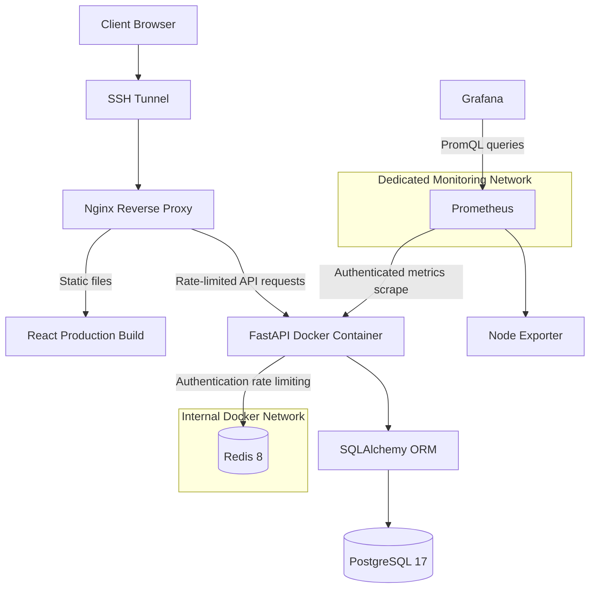
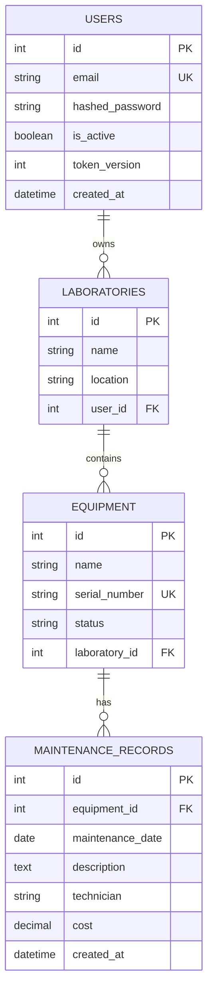
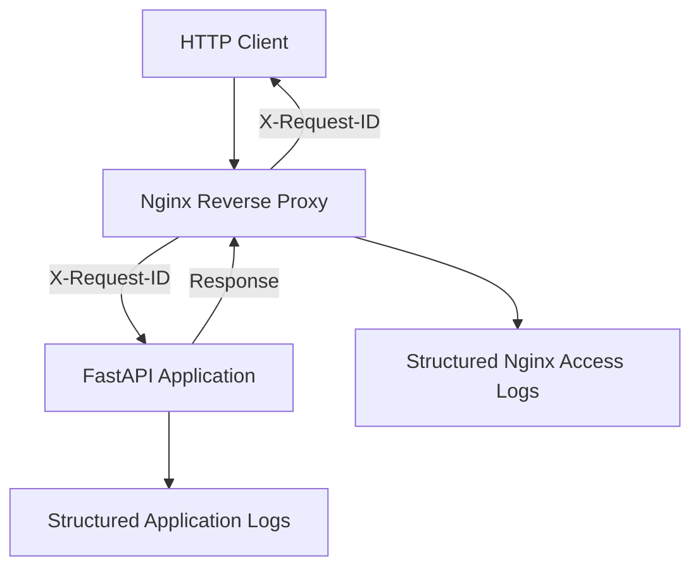
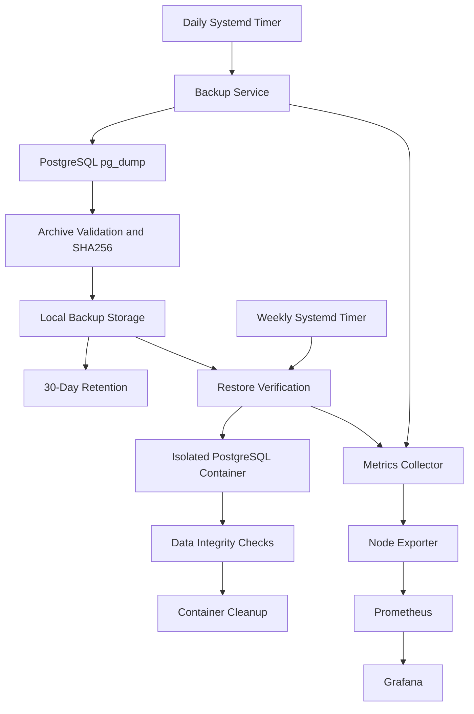

# LabManager

[](https://github.com/ozdereomer/LabManager/actions/workflows/ci.yml)


## Overview

LabManager is a full-stack laboratory and equipment management
application designed to simplify laboratory operations, equipment
inventory management, maintenance tracking, and reporting.

The application combines a FastAPI REST API, a React frontend,
PostgreSQL persistence, JWT authentication, Redis-backed rate
limiting, automated testing, containerized backend deployment,
an Nginx reverse proxy with traffic protection, and
Prometheus and Grafana for application observability.

## Features

### Authentication and Account Management

- User registration and login
- JWT-based authentication
- Argon2 password hashing
- User-specific data isolation
- Account profile management
- Email and password updates
- Token invalidation after credential changes
- Centralized frontend session expiration handling
- Protected frontend routes
- Redis-backed authentication rate limiting
- Per-account and global request limits
- Atomic rate limit enforcement using Lua
- HTTP 429 responses with Retry-After headers from the API
- HTTP 503 responses when the rate limiting service is unavailable
- User-friendly frontend handling of rate limits and service outages

### Laboratory Management

- Create, list, update, and delete laboratories
- Manage laboratory names and locations
- View equipment assigned to each laboratory
- Prevent deletion of laboratories containing equipment
- Restrict access to user-owned laboratories

### Equipment Management

- Full equipment CRUD operations
- Unique serial number validation
- Equipment status tracking:
  - Available
  - Maintenance
  - Broken
- Filtering by name, serial number, status, and laboratory
- Sorting and pagination
- Equipment statistics
- User-specific equipment access control

### Maintenance Management

- Create, view, update, and delete maintenance records
- Track maintenance dates and descriptions
- Record technician information
- Track maintenance costs
- View equipment maintenance history
- Prevent deletion of equipment with maintenance records

### Dashboard

- Laboratory and equipment statistics
- Equipment status overview
- Total maintenance records
- Total maintenance costs
- Laboratory equipment distribution
- Recent maintenance activity

### Observability and Monitoring

- Prometheus-compatible application metrics
- HTTP request counts grouped by method, route, and status
- Request duration histograms and P95 latency monitoring
- In-progress HTTP request tracking
- Authentication outcome metrics
- Rate limit rejection and backend error metrics
- Bearer token-protected metrics endpoint
- Dedicated internal Docker monitoring network
- Nginx protection against public metrics access
- Version-controlled Grafana dashboard with 10 panels
- Real-time monitoring with a 15-second scrape interval
- Low-cardinality metric labels without user identifiers
- Structured JSON application and Nginx access logging
- End-to-end request ID correlation
- Concurrent request context isolation
- HTTP method and status normalization
- Docker API log rotation

### Database Backup and Recovery

- Automated daily PostgreSQL logical backups
- Compressed custom-format backup archives
- SHA256 backup integrity verification
- Atomic backup publication
- 30-day backup retention policy
- Weekly isolated database restore verification
- Shared locking for concurrent backup operations
- Persistent Systemd timers
- Prometheus backup and recovery metrics
- Dedicated Grafana dashboard with nine panels

## Technology Stack

| Layer | Technologies |
|---|---|
| Backend | Python 3.12, FastAPI, Uvicorn |
| Frontend | React, Vite, React Router, Axios |
| Database | PostgreSQL 17 |
| Rate Limiting | Redis 8, Lua, redis-py |
| Redis Security | ACL, SHA-256 password hashes, HMAC-SHA256 keys |
| ORM | SQLAlchemy |
| Validation | Pydantic |
| Migrations | Alembic |
| Authentication | JWT, PyJWT, Argon2 |
| Backend Testing | pytest, pytest-cov |
| Frontend Testing | Vitest, React Testing Library |
| Code Quality | ESLint |
| Containerization | Docker, Docker Compose |
| Web Server | Nginx |
| Metrics | Prometheus, prometheus-client |
| Observability | Grafana, PromQL |
| Logging | Python logging, ContextVar, JSON, Nginx |
| CI | GitHub Actions |
| Deployment | Bash, Python, rsync, flock |
| Operating System | Ubuntu Server |

## System Architecture



Nginx serves the compiled React application and forwards requests
under `/api/` to the FastAPI backend.

The frontend and backend share the same browser origin.

The current server deployment binds Nginx and the backend API
to localhost. Remote access is provided through an SSH tunnel.

The Vite development server is not required in production.

The application uses two complementary traffic protection layers:

1. Nginx applies shared request limits before forwarding API traffic.
2. FastAPI uses Redis to enforce authentication and account-specific
   limits.

Redis is connected to the API through an internal Docker network.
It has no published host port and requires ACL authentication.

PostgreSQL remains on a separately managed external Docker network.

Redis stores temporary rate limit counters rather than laboratory
records, equipment data, passwords, or JWT access tokens.

Prometheus collects application metrics through a dedicated internal
Docker network using Bearer token authentication.

Grafana queries Prometheus to visualize API availability, traffic,
latency, authentication outcomes, and rate limiting events.

Nginx blocks access to the application metrics endpoint.
Prometheus and Grafana are managed separately from the application
stack and are bound to localhost in the current deployment.

## Database Relationships



## Project Structure

```text
LabManager/
├── .github/
│   └── workflows/
│       └── ci.yml
├── app/
│   ├── main.py
│   ├── auth.py
│   ├── security.py
│   ├── rate_limiter.py
│   ├── redis_client.py
│   ├── metrics.py
│   ├── monitoring.py
│   ├── logging_config.py
│   ├── request_logging.py
│   ├── uvicorn_logging.py
│   ├── uvicorn_log_config.json
│   ├── database.py
│   ├── models.py
│   └── schemas/
├── frontend/
│   ├── src/
│   │   ├── components/
│   │   ├── pages/
│   │   ├── services/
│   │   ├── tests/
│   │   └── utils/
│   ├── package.json
│   ├── package-lock.json
│   └── vite.config.js
├── deploy/
│   ├── nginx/
│   │   ├── labmanager.conf
│   │   ├── labmanager-rate-limit.conf
│   │   └── labmanager-logging.conf
│   ├── grafana/
│   │   └── labmanager-dashboard.json
│   ├── redis/
│   │   └── users.acl (generated, ignored by Git)
│   └── scripts/
│       ├── deploy-frontend.sh
│       ├── setup-redis-acl.py
│       └── test-redis-integration.sh
├── migrations/
│   └── versions/
├── tests/
├── .env.example
├── .dockerignore
├── .gitignore
├── Dockerfile
├── compose.yaml
├── alembic.ini
├── pytest.ini
├── requirements.txt
├── requirements-dev.txt
└── README.md
```

## API Endpoints

All endpoints below are relative to the backend API root.
When accessing the application through Nginx, use the `/api`
prefix.

### General

| Method | Endpoint | Description |
|---|---|---|
| GET | `/` | API information |
| GET | `/health` | Application health check |

### Authentication

| Method | Endpoint | Description |
|---|---|---|
| POST | `/register` | Register a user |
| POST | `/login` | Authenticate and receive an access token |

### Account Management

| Method | Endpoint | Description |
|---|---|---|
| GET | `/users/me` | Retrieve account information |
| PUT | `/users/me/email` | Update email address |
| PUT | `/users/me/password` | Update password |

### Laboratories

| Method | Endpoint | Description |
|---|---|---|
| GET | `/laboratories` | List owned laboratories |
| POST | `/laboratories` | Create a laboratory |
| PUT | `/laboratories/{id}` | Update a laboratory |
| DELETE | `/laboratories/{id}` | Delete a laboratory |
| GET | `/laboratories/{id}/equipment` | List laboratory equipment |

### Equipment

| Method | Endpoint | Description |
|---|---|---|
| GET | `/equipment` | List and filter equipment |
| POST | `/equipment` | Create equipment |
| PUT | `/equipment/{id}` | Update equipment |
| DELETE | `/equipment/{id}` | Delete equipment |
| GET | `/equipment/stats` | Retrieve equipment statistics |

### Maintenance

| Method | Endpoint | Description |
|---|---|---|
| GET | `/maintenance` | List maintenance records |
| POST | `/maintenance` | Create a maintenance record |
| PUT | `/maintenance/{id}` | Update a maintenance record |
| DELETE | `/maintenance/{id}` | Delete a maintenance record |

### Dashboard

| Method | Endpoint | Description |
|---|---|---|
| GET | `/dashboard` | Retrieve dashboard statistics |

### Filtering and Pagination

The equipment endpoint supports the following query parameters:

- `name`
- `serial_number`
- `status`
- `laboratory_id`
- `sort_by`
- `order`
- `skip`
- `limit`

Example:

```http
GET /equipment?status=available&sort_by=name&order=asc&skip=0&limit=10
```

## Installation

### Prerequisites

- Git
- Docker Engine
- Docker Compose v2
- Node.js 24
- npm
- PostgreSQL 17
- Python 3 for Redis ACL setup
- OpenSSL for secure secret generation
- Nginx for production frontend hosting
- rsync and flock for frontend deployment

### Clone the Repository

```bash
git clone https://github.com/ozdereomer/LabManager.git
cd LabManager
```

### Environment Variables

For a fresh installation, create the environment file:

```bash
cp -n .env.example .env
chmod 600 .env
```

Generate three independent random secrets locally:

```bash
openssl rand -hex 32
openssl rand -hex 32
openssl rand -hex 32
```

Edit the environment file:

```bash
nano .env
```

| Variable | Purpose |
|---|---|
| POSTGRES_PASSWORD | Existing PostgreSQL application password |
| JWT_SECRET_KEY | Independent JWT signing secret |
| REDIS_PASSWORD | Independent 64-character lowercase hexadecimal password |
| METRICS_TOKEN | Independent 64-character hexadecimal metrics access token |

The PostgreSQL username and database name are fixed in compose.yaml.
POSTGRES_USER and POSTGRES_DB document the expected configuration.

Use a URL-safe database password or correctly encode reserved
characters in the database connection URL.

Use separate generated values for JWT_SECRET_KEY,
REDIS_PASSWORD, and METRICS_TOKEN.

Never commit real credentials, signing keys, ACL files, or access tokens.

### Redis ACL Configuration

Generate the private Redis ACL file:

```bash
python3 deploy/scripts/setup-redis-acl.py
```

The setup script:

- Requires environment file permissions of 600.
- Validates the Redis password format.
- Stores a SHA-256 password hash in the ACL file.
- Creates the ACL file with permissions of 640.
- Preserves an existing valid ACL configuration.
- Rejects mismatched configurations without overwriting them.

The verified Redis image runs with UID 999 and GID 1000.
The container must be able to read the generated ACL file.

Check file permissions and ownership:

```bash
stat -c '%a %u %g' deploy/redis/users.acl
```

If necessary, assign the Redis-compatible group:

```bash
sudo chgrp 1000 deploy/redis/users.acl
```

Do not make the private ACL file world-readable.

Credential rotation requires coordinated changes to the
environment, ACL configuration, and running containers.
The setup script does not automatically rotate credentials.

### PostgreSQL Configuration

The current Docker Compose configuration requires an existing
PostgreSQL instance with the following settings:

| Setting | Value |
|---|---|
| Hostname | `postgres-db` |
| Port | `5432` |
| Database | `labmanager` |
| Database user | `labmanager_user` |
| Docker network | `postgres-db_default` |

Provision the database, application user, and external Docker
network before starting the backend.

The PostgreSQL container is managed separately from this
repository's Compose services.

### Start the Backend

Create the dedicated monitoring network before starting the API.
This is required even when Prometheus is not installed.

```bash
sudo docker network inspect labmanager_monitoring >/dev/null 2>&1 || \
    sudo docker network create --driver bridge --internal labmanager_monitoring
```

Verify that the network is internal:

```bash
sudo docker network inspect labmanager_monitoring --format '{{.Internal}}'
```

The expected output is true. Do not proceed if an existing network
with this name is not internal.


```bash
sudo docker compose up -d --build redis api
```

Check container status:

```bash
sudo docker compose ps
```

Apply database migrations:

```bash
sudo docker compose exec api python -m alembic upgrade head
```

Check application health:

```bash
curl -fsS http://127.0.0.1:8001/health
```

Expected response:

```json
{"status":"healthy"}
```

The health endpoint confirms application responsiveness.
It is not a comprehensive PostgreSQL or Redis readiness check.

Verify authenticated Redis connectivity separately:

```bash
sudo docker compose exec redis redis-cli --user labmanager ping
```

The expected response is PONG. The Redis container health check
also verifies authenticated connectivity.

### Frontend Development

```bash
cd frontend
npm ci
npm run dev
```

The development server uses port `3002` and proxies `/api`
requests to the backend.

### API Documentation

FastAPI provides interactive API documentation:

- Swagger UI: `http://127.0.0.1:8001/docs`
- ReDoc: `http://127.0.0.1:8001/redoc`
- OpenAPI: `http://127.0.0.1:8001/openapi.json`

For remote development, forward the backend port through SSH:

```bash
ssh -N -L 127.0.0.1:8001:127.0.0.1:8001 user@server-ip
```

Swagger and ReDoc should currently be accessed through the
direct backend tunnel rather than the Nginx API prefix.

## Automated Testing

### Latest Verified Test Results

| Test suite | Passing tests | Measured coverage |
|---|---:|---:|
| Backend | 229 | 100% |
| Redis integration | 16 | Not measured separately |
| Frontend | 212 | 100% |
| Total | 457 | |

These results describe the latest verified local test runs.

Coverage measures the configured application source files.
It does not guarantee the absence of defects.

### Backend Tests

The Dockerfile separates production and test image targets.

Build the dedicated test image:

```bash
sudo docker compose build api-test
```

Run the isolated backend test suite:

```bash
sudo docker compose run --rm --no-deps api-test
```

Backend tests use an in-memory SQLite database and a
test-only JWT secret. The test container has no network access.

Production database records are not used by this test suite.

The backend coverage threshold is configured at 100%.

The standard backend suite mocks the rate limiting service
and skips the 16 opt-in Redis integration tests.

### Redis Integration Tests

Run the dedicated integration test script:

```bash
sudo bash deploy/scripts/test-redis-integration.sh
```

The script creates a temporary test image, internal Docker
network, Redis container, and test-only ACL configuration.

Integration tests use an in-memory SQLite database and
dedicated test credentials instead of production services.

The suite verifies:

- Atomic rate limit enforcement under concurrent requests.
- Counter expiration and remaining retry time.
- Isolation between identifiers and rate limit scopes.
- Recovery of counters with missing expiration.
- Login and registration limits.
- Account credential update limits.
- Global authentication request limits.
- Fail-closed behavior during Redis connection failures.

Temporary resources are removed on normal completion and
handled failures. Forced termination or host failure may
require manual cleanup.

Integration tests run separately without coverage measurement.
PostgreSQL integration and concurrency testing remain planned
improvements.

### Frontend Tests

```bash
cd frontend
npm ci
npm run test:coverage
npm run lint
npm run build
```

The frontend coverage threshold is configured at 95% for
statements, branches, functions, and lines.

The latest verified frontend run achieved 100% across all
four configured coverage metrics.

### Test Scope

- Authentication and authorization
- JWT validation and expiration
- User data isolation
- Laboratory, equipment, and maintenance operations
- Account management
- Input validation and error handling
- Frontend components and forms
- API interceptors and session handling
- Protected routes
- Dashboard behavior
- Redis rate limiting and concurrent requests
- Authentication service failure handling
- Frontend HTTP 429 and HTTP 503 error handling

## Continuous Integration

GitHub Actions runs automated checks for pull requests and
pushes to the main branch.

### Backend Pipeline

- Install Python dependencies
- Check dependency consistency
- Execute backend tests
- Enforce coverage requirements
- Build an isolated Redis integration test environment
- Execute Redis integration tests
- Clean up temporary integration test resources

### Frontend Pipeline

- Install locked npm dependencies
- Execute frontend tests
- Enforce coverage requirements
- Run ESLint
- Build production assets

The current pipeline provides continuous integration.
Production deployment is manually initiated and is not
automatically triggered by GitHub Actions.

## Production Docker Configuration

The backend uses a multi-stage Dockerfile with separate
production and testing targets.

Production characteristics:

- Python slim base image
- Non-root application user
- Test dependencies excluded
- Test source files excluded
- Localhost-only published API port
- Automatic container restart policy
- Structured JSON API logging
- Docker log rotation with 10 MB files and 3 retained files
- External PostgreSQL network integration
- Internal Docker network for Redis communication
- Redis image pinned by SHA-256 digest
- No published Redis host port
- Restricted Redis ACL permissions
- Redis AOF persistence with every-second synchronization
- Redis memory limit of 64 MB with noeviction policy
- Redis container memory limit of 128 MB
- Authenticated Redis container health checks
- Private environment and ACL files excluded from build context

The test image includes development dependencies and
uses an isolated test environment.

## Nginx Production Deployment

### Install Required Packages

On Ubuntu Server:

```bash
sudo apt update
sudo apt install -y nginx rsync util-linux
```

### Build the Frontend

```bash
cd frontend
npm ci
npm run test:coverage
npm run lint
npm run build
cd ..
```

### Publish Static Files

```bash
sudo mkdir -p /var/www/labmanager

sudo rsync -a \
    --chown=root:root \
    --chmod=D755,F644 \
    frontend/dist/ /var/www/labmanager/
```

### Install Nginx Configuration

```bash
sudo install -m 644 deploy/nginx/labmanager-rate-limit.conf /etc/nginx/conf.d/labmanager-rate-limit.conf
sudo install -m 644 deploy/nginx/labmanager-logging.conf /etc/nginx/conf.d/labmanager-logging.conf

sudo install -m 644 \
    deploy/nginx/labmanager.conf \
    /etc/nginx/sites-available/labmanager

sudo ln -s \
    /etc/nginx/sites-available/labmanager \
    /etc/nginx/sites-enabled/labmanager
```

On a dedicated server, disable the default Nginx site
if it is enabled and not needed:

```bash
sudo unlink /etc/nginx/sites-enabled/default
```

Validate the configuration and restart Nginx:

```bash
sudo nginx -t
sudo systemctl restart nginx
sudo systemctl enable nginx
```

A restart may be necessary when changing the listening
address from a wildcard address to localhost.

### Verify the Deployment

```bash
curl -I http://127.0.0.1/
curl -fsS http://127.0.0.1/api/health
curl -i http://127.0.0.1/api/equipment
```

Expected results:

- Frontend: HTTP 200
- API health: HTTP 200
- Unauthenticated equipment request: HTTP 401

### Remote Access

From the client machine:

```bash
ssh -N -o ExitOnForwardFailure=yes \
    -L 127.0.0.1:8080:127.0.0.1:80 \
    user@server-ip
```

Open:

```text
http://127.0.0.1:8080
```

The SSH tunnel encrypts network traffic between the client
and the server.

The current deployment does not expose Nginx directly
to the public internet.

## Automated Frontend Deployment

After the initial Nginx setup, update the frontend using:

```bash
./deploy/scripts/deploy-frontend.sh
```

Run the script as a regular user with sudo privileges.

The deployment script performs:

1. Environment validation
2. Dependency installation
3. Automated tests and lint checks
4. Production build
5. Backup of the previous frontend
6. Publication of new frontend assets
7. HTTP health and HTML content checks

### Deployment Safety

- Concurrent deployments are blocked using flock.
- Failed tests prevent publication.
- Existing frontend files are backed up.
- The new index.html is published after static assets.
- Previous hashed assets are retained.
- Publication or health-check command failures trigger
  a rollback attempt.

Backups are stored under:

```text
/var/backups/labmanager/frontend/
```

The successful deployment path, backup integrity,
concurrent deployment protection, and isolated rollback
function have been tested.

The deployment is not fully atomic and does not guarantee
recovery from power loss, process termination, or every
possible filesystem and permission failure.

Automatic backup and old asset retention policies are
planned improvements.

## Application Observability

LabManager exposes application-level metrics using the
Prometheus Python client and a custom ASGI monitoring middleware.

Prometheus collects metrics every 15 seconds, while Grafana
provides a version-controlled operational dashboard.

### Available Metrics

| Metric | Type | Labels |
|---|---|---|
| labmanager_http_requests_total | Counter | method, route, status |
| labmanager_http_request_duration_seconds | Histogram | method, route |
| labmanager_http_requests_in_progress | Gauge | None |
| labmanager_authentication_attempts_total | Counter | outcome |
| labmanager_rate_limit_rejections_total | Counter | scope |
| labmanager_rate_limit_errors_total | Counter | scope |

HTTP route templates are used instead of raw request paths
to reduce metric cardinality.

Unmatched routes are grouped under a shared label.
Unexpected HTTP methods are grouped under OTHER.

Metric labels do not contain email addresses, user IDs,
passwords, JWTs, or raw query parameters.

### Metrics Endpoint

The API exposes GET /metrics on its internal HTTP interface.

- A valid Bearer token is required.
- Missing or incorrect credentials return HTTP 401.
- Missing server-side token configuration returns HTTP 503.
- The endpoint is excluded from the OpenAPI schema.
- Metrics collection requests are excluded from normal HTTP metrics.
- Nginx blocks /api/metrics with HTTP 404.

Verify unauthenticated access:

```bash
curl -s -o /dev/null -w 'HTTP %{http_code}\\n' \
    http://127.0.0.1:8001/metrics
```

The expected response is HTTP 401.

After installing the Nginx configuration, verify proxy protection:

```bash
curl -s -o /dev/null -w 'HTTP %{http_code}\\n' \
    http://127.0.0.1/api/metrics
```

The expected response is HTTP 404.

### Prometheus Token File

Prometheus uses a read-only credential file instead of storing
the metrics token directly in its YAML configuration.

The following example assumes that Prometheus runs with
UID and GID 65534. Verify these values for your deployment.

From the repository root, create the credential file:

```bash
sudo python3 - <<'TOKENPY'
import os
import re
from pathlib import Path

values = [
    line.split("=", 1)[1]
    for line in Path(".env").read_text().splitlines()
    if line.startswith("METRICS_TOKEN=")
]

if len(values) != 1:
    raise SystemExit("Expected exactly one METRICS_TOKEN")

token = values[0]

if not re.fullmatch(r"[0-9a-f]{64}", token):
    raise SystemExit("Invalid metrics token format")

directory = Path("/etc/labmanager-monitoring")
directory.mkdir(mode=0o700, exist_ok=True)
os.chown(directory, 0, 0)
directory.chmod(0o700)

target = directory / "metrics-token"

fd = os.open(
    target,
    os.O_WRONLY | os.O_CREAT | os.O_EXCL,
    0o400
)

with os.fdopen(fd, "w") as output:
    output.write(token)
    output.flush()
    os.fchown(output.fileno(), 65534, 65534)
    os.fchmod(output.fileno(), 0o400)

print("Metrics credential file created")
TOKENPY
```

This command does not display the token and refuses to
overwrite an existing credential file.

Keep the credential file outside the repository.
Token rotation requires coordinated updates to the API
environment and the Prometheus credential file.

### Prometheus Configuration

Prometheus and Grafana are managed separately from the
LabManager application stack.

Create the monitoring network as described in the
backend installation instructions.

Add the following job to the existing Prometheus
scrape_configs list:

```yaml
  - job_name: labmanager
    scrape_interval: 15s
    scrape_timeout: 5s
    metrics_path: /metrics
    scheme: http
    authorization:
      type: Bearer
      credentials_file: /run/secrets/metrics-token
    static_configs:
      - targets: ['labmanager-api:8000']
```

Merge the following settings into the existing monitoring
Docker Compose configuration:

```yaml
services:
  prometheus:
    volumes:
      - type: bind
        source: /etc/labmanager-monitoring/metrics-token
        target: /run/secrets/metrics-token
        read_only: true
    networks:
      - default
      - labmanager_monitoring

networks:
  default:
  labmanager_monitoring:
    external: true
    name: labmanager_monitoring
```

This is a configuration fragment, not a complete Compose file.

Preserve the existing Prometheus configuration mount,
persistent storage, image settings, and other scrape jobs.

Validate the configuration with promtool before redeployment.

Back up the existing configuration and recreate Prometheus
without removing its persistent volume.

Verify that the Prometheus targets page reports the
labmanager job as UP.

### Grafana Dashboard

The dashboard definition is stored at:

```text
deploy/grafana/labmanager-dashboard.json
```

Configure a Prometheus data source in Grafana.

Import the JSON file through Dashboards > New > Import
and select the Prometheus data source.

The dashboard contains ten panels:

- API Availability
- Requests per Second
- Server Error Rate
- P95 Response Time
- HTTP Traffic by Status
- Average and P95 Latency
- Active Requests
- Authentication Attempts
- Rate Limit Rejections
- Rate Limiter Errors

The default time range is 15 minutes.
The dashboard refresh interval is 15 seconds.
Rate and latency calculations use five-minute windows.

The dashboard uses the stable UID labmanager-observability.

### Remote Monitoring Access

The current deployment binds Grafana and Prometheus
to localhost rather than exposing them publicly.

Access Grafana through an SSH tunnel:

```bash
ssh -N -L 127.0.0.1:3001:127.0.0.1:3000 user@server
```

Open http://127.0.0.1:3001 in your browser.

Replace user and server with your SSH connection details.

### Monitoring Limitations

- Metrics are stored in the API process and reset on restart.
- The current implementation assumes a single Uvicorn worker.
- Multi-worker metrics aggregation is not configured.
- Prometheus scrape availability is not a complete database
  or Redis readiness check.
- Metrics describe requests reaching FastAPI, not requests
  rejected directly by Nginx.
- Authentication outcome metrics exclude attempts rejected
  before credential evaluation.
- Event-specific metric series appear after the first event.
- No data does not necessarily mean zero events or a healthy service.
- Prometheus increase() can produce fractional estimates.
- P95 latency is estimated from histogram buckets.
- Short-lived requests may not appear in sampled in-progress metrics.
- The monitoring connection uses HTTP inside the Docker network.
- Privileged Docker users can access container credentials.
- Dashboard thresholds are initial visual indicators,
  not validated service-level objectives.
- Automated alerting and comprehensive load testing
  are not implemented.

## Structured Logging and Request Correlation

LabManager provides structured JSON logging across FastAPI,
Uvicorn, and the Nginx reverse proxy.

### Logging Architecture



Nginx generates a unique request identifier and replaces
client-supplied request identifiers before forwarding requests
to the backend.

The backend preserves valid 32-character lowercase hexadecimal
request identifiers and generates a new identifier when an
incoming identifier is missing, duplicated, or invalid.

Request context is maintained using Python ContextVar to
isolate concurrent requests.

The same identifier is included in the HTTP response,
Nginx access log, and application request log.

### Backend JSON Logging

Application logs include the following fields:

| Field | Description |
| --- | --- |
| timestamp | UTC timestamp |
| level | Logging severity |
| logger | Logger name |
| event | Event description |
| request_id | Request correlation identifier |
| method | Normalized HTTP method |
| route | Route template or unmatched |
| status_code | HTTP response status |
| duration_ms | Request duration in milliseconds |
| error_type | Exception class when applicable |

Example request log:

```json
{
  "timestamp": "2026-11-27T20:33:40.726072+00:00",
  "level": "INFO",
  "logger": "labmanager",
  "event": "request_completed",
  "request_id": "205bbcfb40e2407eb44394cb05ab4256",
  "method": "GET",
  "route": "/health",
  "status_code": 200,
  "duration_ms": 0.494
}
```

Successful GET requests to the metrics endpoint are excluded
from application request completion logs to reduce monitoring
noise. Failed metrics requests remain visible.

Uvicorn access logging is disabled to avoid duplicate request
logs and unnecessary exposure of raw request URLs.

Uvicorn exception records are formatted without raw exception
messages or traceback details.

### Nginx JSON Access Logging

The Nginx configuration uses a dedicated JSON access log format.

Configuration files:

- deploy/nginx/labmanager.conf
- deploy/nginx/labmanager-logging.conf
- deploy/nginx/labmanager-rate-limit.conf

Nginx access logs include request identifiers, HTTP methods,
response status codes, upstream status, request duration,
upstream response duration, and response size.

Unknown HTTP methods are normalized to OTHER.
Status values outside the 100-599 range are normalized to 0.

Nginx duration values are measured in seconds, while backend
request durations are measured in milliseconds.

Requests rejected by Nginx rate limiting retain their request
identifiers and security headers. An empty upstream status
indicates that no upstream response was recorded.

### Logging Privacy

Application request completion logs use route templates
instead of raw request paths.

The configured request log formats do not intentionally
include:

- Authorization headers
- JWT access tokens
- Passwords
- Cookies
- Request bodies
- Query strings
- Raw exception messages

Unhandled application exceptions produce generic HTTP 500
responses and structured error events.

These protections apply to the configured logging paths.
They do not constitute comprehensive sensitive data redaction
for every possible logger or infrastructure component.

### Log Rotation and Retention

The API container uses Docker json-file logging with:

| Setting | Value |
| --- | --- |
| max-size | 10m |
| max-file | 3 |

This limits retained API container logs to approximately
30 MB, subject to individual log record size.

The production Ubuntu Nginx installation uses daily log
rotation with 14 retained rotations and compression.

Nginx rotation is managed by the host operating system.
Daily rotation does not impose a strict maximum disk usage.

### Inspecting Logs

Inspect recent application logs:

```bash
sudo docker logs --since 10m labmanager-api
```

Inspect recent Nginx access logs:

```bash
sudo tail -n 20 /var/log/nginx/labmanager-access.log
```

Check the active Docker logging configuration:

```bash
sudo docker inspect labmanager-api --format '{{json .HostConfig.LogConfig}}'
```

Use the X-Request-ID response header to correlate records
between Nginx and FastAPI.

### Logging Verification

The structured logging implementation was verified through:

- JSON formatter unit tests
- Request middleware tests
- Concurrent request context isolation tests
- Request identifier validation tests
- FastAPI integration tests
- Uvicorn exception formatting tests
- Isolated Nginx HTTP tests
- End-to-end reverse proxy correlation tests
- Nginx HTTP 429 logging tests
- Production request correlation checks
- Production security regression checks
- Prometheus and Grafana availability checks

The latest verified automated test results include 229 backend
tests, 16 Redis integration tests, and 212 frontend tests.

### Logging Limitations

- Nginx error logs may contain raw URLs or query strings.
- Third-party loggers are not universally sanitized.
- Direct backend callers can supply valid request identifiers.
  Nginx replaces these identifiers at the proxy boundary.
- Request identifiers are correlation metadata, not
  authentication credentials.
- Uvicorn exception logs may not retain request context after
  the application middleware resets it.
- Historical Nginx access logs may contain non-JSON records
  created before the logging deployment.
- Docker log retention is local to the container.
- Centralized log aggregation is not yet implemented.
- Deployment rollback has not been exercised end to end.
- The status 000 fallback has not been directly reproduced.
- Container recreation may remove previous container logs.
- Full test coverage does not guarantee absence of defects.

## Database Backup and Recovery

LabManager provides automated PostgreSQL logical backups
and isolated restore verification independently of the
application API and frontend.

### Backup Architecture



### Backup Schedule

| Operation | Schedule |
| --- | --- |
| Database backup | Daily at 03:00 |
| Restore verification | Sunday at 04:00 |
| Backup retention | 30 days |
| Service startup timeout | 15 minutes |
| Shared lock wait timeout | 120 seconds |

Schedules use the Europe/Istanbul timezone.

Persistent Systemd timers allow missed calendar events
to be triggered after the timer becomes active again.

### Backup Storage

Backups are stored under:

```text
/var/backups/labmanager/database/
    .backup.lock
    labmanager-YYYYMMDDTHHMMSSZ/
        database.dump
        archive-list.txt
        SHA256SUMS
```

Backup directory names use UTC timestamps.

Each backup contains a compressed PostgreSQL custom-format
archive, an archive table-of-contents listing, and a SHA256
checksum manifest.

The backup script creates files in a temporary directory,
validates the archive listing, verifies the checksum, and
publishes the completed backup using a directory rename.

Retention runs only after a new backup has been published.
Unrelated directories and incomplete backup candidates
are excluded from normal retention cleanup.

Backup and restore operations share an exclusive file lock
to prevent concurrent execution.

### Restore Verification

The restore verification script selects the latest backup
and validates its checksum before restoring it.

The restore environment uses the same PostgreSQL image
as the production database container.

Isolation and resource controls include:

- No Docker network connectivity
- No published network ports
- Temporary database storage using tmpfs
- 256 MiB temporary storage limit
- 512 MiB container memory limit
- One CPU allocation
- A separate verification database
- Automatic cleanup on normal exit and handled errors

The archive is restored using a single transaction with
exit-on-error enabled.

Verification includes:

- Required application tables
- Table record counts
- Alembic migration metadata
- Foreign key orphan detection
- Unvalidated constraint detection

Production database contents are not modified by the
restore verification process.

### Backup Infrastructure Installation

The scripts target a Linux host with Systemd, Docker,
Python 3, Bash, flock, and standard core utilities.

The production PostgreSQL container is expected to be
named postgres-db, with database labmanager and database
user labmanager_user.

Review these deployment assumptions before installation.

Run the following commands from the repository root.

```bash
sudo install -d -o root -g root -m 700 /var/backups/labmanager/database
sudo install -d -o root -g root -m 755 /var/lib/labmanager/metrics

sudo install -o root -g root -m 750 deploy/scripts/backup-database.sh /usr/local/sbin/labmanager-backup-database

sudo install -o root -g root -m 750 deploy/scripts/verify-database-backup.sh /usr/local/sbin/labmanager-verify-database-backup

sudo install -o root -g root -m 750 deploy/scripts/write-backup-metrics.py /usr/local/sbin/labmanager-write-backup-metrics

sudo install -o root -g root -m 750 deploy/scripts/collect-backup-metrics.sh /usr/local/sbin/labmanager-collect-backup-metrics

sudo install -o root -g root -m 644 deploy/systemd/labmanager-backup.service /etc/systemd/system/
sudo install -o root -g root -m 644 deploy/systemd/labmanager-backup.timer /etc/systemd/system/
sudo install -o root -g root -m 644 deploy/systemd/labmanager-restore-verify.service /etc/systemd/system/
sudo install -o root -g root -m 644 deploy/systemd/labmanager-restore-verify.timer /etc/systemd/system/

sudo systemctl daemon-reload

sudo systemd-analyze verify /etc/systemd/system/labmanager-backup.service /etc/systemd/system/labmanager-restore-verify.service

sudo systemctl start labmanager-backup.service
sudo systemctl start labmanager-restore-verify.service

sudo systemctl enable --now labmanager-backup.timer labmanager-restore-verify.timer
```

The root-owned installed scripts are separated from the
developer-writable repository directory.

### Manual Backup and Restore Operations

Trigger a database backup:

```bash
sudo systemctl start labmanager-backup.service
```

Verify the latest backup:

```bash
sudo systemctl start labmanager-restore-verify.service
```

Inspect timer schedules:

```bash
systemctl list-timers 'labmanager-*' --no-pager
```

Inspect service logs:

```bash
sudo journalctl -u labmanager-backup.service --no-pager -n 100
sudo journalctl -u labmanager-restore-verify.service --no-pager -n 100
```

### Backup Security

- Backup directories are owned by root with mode 700.
- Backup archive files use mode 600.
- Installed executable scripts use mode 750.
- Systemd unit files use mode 644.
- Backup and restore operations share an exclusive lock.
- Systemd services use filesystem protection and
  NoNewPrivileges.
- Restore containers have no network connectivity.
- Database contents are not exposed through metrics.
- Metrics files are published atomically with mode 644.

The restore container uses trust authentication only
inside its isolated verification environment.

Access to the Docker daemon remains highly privileged.
Systemd hardening does not eliminate the privileges
associated with Docker daemon access.

### Backup and Recovery Metrics

Systemd invokes the metrics collector through ExecStopPost
after backup and restore operations.

The collector uses the service result and monotonic
execution timestamps to report status and duration.

| Metric | Description |
| --- | --- |
| labmanager_backup_success | Latest backup result |
| labmanager_backup_last_success_timestamp_seconds | Last successful backup timestamp |
| labmanager_backup_duration_seconds | Backup execution duration |
| labmanager_backup_count | Number of complete backup candidates |
| labmanager_backup_size_bytes | Latest backup archive size |
| labmanager_restore_success | Latest restore verification result |
| labmanager_restore_last_success_timestamp_seconds | Last successful restore timestamp |
| labmanager_restore_duration_seconds | Restore execution duration |

Success metrics use 1 for success and 0 for failure.

Failed operations preserve the previous successful
operation timestamp. A zero timestamp indicates that
no successful operation has been recorded.

Metrics are published atomically to:

```text
/var/lib/labmanager/metrics/labmanager_backup.prom
/var/lib/labmanager/metrics/labmanager_restore.prom
```

### Node Exporter Integration

Add the following argument to the existing Node Exporter
command configuration:

```yaml
- "--collector.textfile.directory=/textfile"
```

Add the following read-only volume:

```yaml
- /var/lib/labmanager/metrics:/textfile:ro
```

Preserve the existing Node Exporter configuration,
including the host filesystem mount and rootfs argument.

Recreate only the Node Exporter container when possible.

The existing Prometheus Node Exporter scrape job
collects the backup metrics without requiring
a separate scrape target.

### Grafana Backup Dashboard

The version-controlled dashboard is available at:

```text
deploy/grafana/labmanager-backup-dashboard.json
```

Import the JSON file into Grafana and select the
existing Prometheus datasource.

The dashboard includes nine panels:

- Backup status
- Restore verification status
- Total backups
- Last successful backup
- Last successful restore
- Latest backup size
- Backup duration
- Restore duration
- Textfile collector scrape errors

The dashboard refreshes every 15 seconds and displays
timestamps in UTC.

### Verified Backup and Recovery Results

The following results were verified in the self-hosted
deployment on November 27-28, 2026.

| Verification | Result |
| --- | --- |
| Manual database backup | Passed |
| Independent SHA256 verification | Passed |
| Full archive decoding | Passed |
| Isolated PostgreSQL restore | Passed |
| Restored table content comparison | Passed |
| Constraint and index comparison | Passed |
| Sequence comparison | Passed |
| Retention policy checks | Passed |
| Simulated partial backup failure | Passed |
| Simulated corrupted backup | Passed |
| Simulated restore failure and cleanup | Passed |
| Shared lock behavior | Passed |
| Isolated script test checks | 59 passed |
| Systemd failure environment test | Passed |
| Natural daily timer activation | Passed |
| Prometheus backup and restore metrics | 8/8 |
| Grafana panel query validation | 9/9 |
| Node Exporter textfile scrape errors | 0 |
| Production API health | Healthy |

The isolated script checks were executed manually using
temporary fixtures and controlled failure scenarios.

They are separate from the automated application test
suite and are not included in its test count.

The first natural daily timer activation occurred at
03:00:14 Europe/Istanbul on November 28, 2026.

The resulting archive was independently checksum-verified
and fully decoded.

Six backup archives were present during verification.

### Backup and Recovery Limitations

- Backups are stored on the production host.
  Disk failure or host loss can destroy both copies.
- Off-site backups and backup encryption are not implemented.
- Logical backups do not provide point-in-time recovery
  or continuous WAL archiving.
- PostgreSQL cluster-wide roles and global objects
  are not included in the database-only dump.
- SHA256 detects corruption but does not establish
  authenticity against privileged tampering.
- Archive listing validation is not a full restore test.
- Weekly restore verification tests only the latest backup.
- Restore verification does not constitute full application
  or disaster recovery testing.
- Fixed restore resource limits may require adjustment
  as the database grows.
- The restore role does not reproduce all production
  database permission boundaries.
- Abrupt termination may prevent cleanup or metric publication.
- Backup metrics represent the latest reported operation.
- Backup inventory metrics may become stale between runs.
- Missing execution timestamps can produce zero duration.
- Metrics publication failures may cause a service to
  report failure even after successful archive creation.
- Automated alerts and stale-metric detection are pending.
- Failure paths were tested using isolated fixtures and
  a separate Systemd test service.
- The weekly timer has been tested manually, but its first
  natural scheduled activation has not yet been observed.
- Persistent timer behavior after a host reboot has not
  been verified end to end.

### Backup Deployment Rollback

Disable future scheduled operations:

```bash
sudo systemctl disable --now labmanager-backup.timer labmanager-restore-verify.timer
```

Check that neither service is running:

```bash
systemctl status labmanager-backup.service labmanager-restore-verify.service --no-pager
```

Wait for active operations to finish before removing
installed unit files.

```bash
sudo rm -f /etc/systemd/system/labmanager-backup.service
sudo rm -f /etc/systemd/system/labmanager-backup.timer
sudo rm -f /etc/systemd/system/labmanager-restore-verify.service
sudo rm -f /etc/systemd/system/labmanager-restore-verify.timer

sudo systemctl daemon-reload
```

Remove the added Node Exporter textfile collector
argument and volume, or restore the previous monitoring
stack configuration after reviewing its differences.

Recreate Node Exporter without changing the Prometheus
or Grafana configuration.

The dedicated backup dashboard may be removed separately.

Preserve all existing database backup archives.

Disabling the backup infrastructure does not require
deleting backup data or modifying the production database.

This rollback procedure has not been executed end to end.

## Security

### Application Security

- Argon2 password hashing
- Signed JWT access tokens
- Access token expiration
- Token version validation
- Credential-change session invalidation
- User-specific resource authorization
- Input validation
- Sanitized validation error responses
- Generic internal server error responses
- Non-root backend container
- Environment-based secret configuration
- Redis-backed authentication rate limiting
- Atomic Lua-based counter updates
- HMAC-SHA256 rate limit identifiers
- Fail-closed authentication protection
- Restricted Redis ACL commands and key namespaces
- Disabled default Redis user
- Private Redis network and authenticated health checks
- Secure environment and ACL file permissions

### Nginx Security

- Localhost-only listener
- Hidden Nginx version
- Content-Security-Policy
- X-Content-Type-Options
- X-Frame-Options
- Referrer-Policy
- Permissions-Policy
- Dedicated access and error logs
- Shared API traffic limits
- Dedicated login and registration limits
- Shared credential update limits
- JSON responses for Nginx-generated HTTP 429 errors

### Authentication Rate Limiting

FastAPI enforces the following Redis-backed limits:

| Operation | Scope | Requests | Window |
|---|---|---:|---:|
| Login | Normalized email | 5 | 60 seconds |
| Login | Global | 100 | 60 seconds |
| Registration | Normalized email | 3 | 60 seconds |
| Registration | Global | 30 | 60 seconds |
| Email update | User ID | 5 | 60 seconds |
| Password update | User ID | 5 | 60 seconds |

Global authentication limits are checked before identifier-specific
limits.

The limits count requests reaching the limiter, including successful
and unsuccessful authentication attempts.

Requests rejected before reaching the limiter are not counted.

Redis uses fixed-duration windows starting with the first accepted
request. Lua scripts update counters and expiration atomically.

Blocked requests do not increment the corresponding blocked counter
or extend its existing expiration window.

Rate limit keys use HMAC-SHA256 identifiers derived from the JWT
signing secret instead of storing raw email addresses.

Rotating the JWT signing secret also changes rate limit identifiers.

### Nginx Traffic Protection

| Scope | Sustained rate | Burst |
|---|---:|---:|
| Login | 120 requests/minute | 20 |
| Registration | 60 requests/minute | 10 |
| Credential updates | 60 requests/minute | 10 |
| General API | 20 requests/second | 40 |

Nginx uses shared leaky-bucket limits with immediate burst handling.

The credential update zone is shared between email and password
update endpoints.

The general API limit also applies to authentication and health
requests.

Limits are shared by clients of the configured server rather than
based on client IP addresses because the current deployment uses
SSH tunnels.

Endpoint-specific Nginx limits use URI mappings. Alternative paths
may not match these mappings but remain subject to the general
API limit and applicable backend rate limits.

### Rate Limit Error Handling

| Condition | HTTP status | Retry-After |
|---|---:|---|
| Backend rate limit exceeded | 429 | Remaining seconds |
| Nginx rate limit exceeded | 429 | Not provided |
| Redis unavailable during a protected operation | 503 | Not provided |

The frontend displays user-friendly messages for these conditions
without treating them as session expiration.

Authentication and credential update operations fail closed when
Redis is unavailable.

Other API operations do not require Redis for normal execution.

### Redis Security and Persistence

- Redis is accessible through an internal Docker network.
- No Redis port is published to the host.
- The default Redis user is disabled.
- The application uses a dedicated restricted ACL user.
- Key access is restricted to the rate limiting namespace.
- Administrative commands are not permitted.
- The ACL file is mounted read-only.
- AOF persistence preserves counters across normal restarts.
- Redis uses a noeviction memory policy.

Redis credentials remain accessible to privileged Docker
administrators. Docker access must therefore be restricted
to trusted users.

### Security Limitations

The current deployment is intended for private access through SSH.

Shared and per-account limits can temporarily affect legitimate
users when another client consumes the available request quota.

Rate limiting reduces abuse but does not eliminate distributed
denial-of-service attacks or account lockout risks.

The configured limits are intended for the current small-scale
deployment and should be reviewed before public exposure.

HTTPS, email verification, password recovery, and server-side
revocation on manual logout are not yet implemented.

### Rate Limiting Deployment Rollback

Before updating an existing deployment, preserve the current API
image and back up both Nginx configuration files where present.

If the new Nginx configuration causes problems:

1. Restore the previous site configuration.
2. Restore the previous rate limit configuration, or remove the
   newly installed rate limit file if none existed before.
3. Validate the restored configuration.
4. Reload Nginx only after validation succeeds.

```bash
sudo nginx -t && sudo systemctl reload nginx
```

To restore a previously preserved API image:

```bash
sudo docker image tag labmanager-api:before-rate-limiting labmanager-api:latest
sudo docker compose up -d --no-deps --no-build --force-recreate api
```

The rollback image tag must exist and refer to the intended
previous application version.

Verify API and reverse proxy responsiveness after rollback:

```bash
curl -fsS http://127.0.0.1:8001/health
curl -fsS http://127.0.0.1/api/health
```

The API image rollback does not restore database schemas,
environment variables, or Docker Compose configuration.

Do not remove Redis volumes or modify database records as part
of an application image rollback.

The rate limiting deployment and smoke tests have been verified
locally. A complete production rollback has not been executed.

### Observability Deployment Rollback

Before deploying monitoring changes, preserve:

- The previous production API image.
- The installed Nginx configuration.
- The Prometheus configuration file.
- The monitoring Docker Compose configuration.
- Existing Prometheus and Grafana persistent volumes.

The following rollback procedure assumes that these
backups were created before deployment.

#### Restore Prometheus

Restore the previous Prometheus configuration and
monitoring Compose definition from their backups.

Validate the restored configuration with promtool.

Redeploy the monitoring stack without pulling new images
or removing persistent volumes.

Verify that the original Prometheus and Node Exporter
scrape targets are healthy.

#### Restore the API Image

The previous API image is retained locally under
the labmanager-api:before-observability tag.

```bash
sudo docker image inspect labmanager-api:before-observability >/dev/null

sudo docker image tag labmanager-api:before-observability labmanager-api:latest

sudo docker compose up -d --no-deps --no-build --force-recreate api
```

This restores the previous application image but does
not restore the previous Compose configuration.

Keep the metrics access protection in Nginx during
the rollback unless there is a specific reason to restore
the previous proxy configuration.

#### Restore Nginx If Required

The previous Nginx configuration is stored outside
the repository in the server backup directory.

```bash
sudo install -m 644 /var/backups/labmanager/nginx/labmanager-before-observability.conf /etc/nginx/sites-available/labmanager

sudo nginx -t && sudo systemctl reload nginx
```

Only restore the previous Nginx configuration when needed.
It does not contain the new metrics access protection.

#### Verify Application Recovery

```bash
curl -fsS http://127.0.0.1:8001/health

curl -fsS http://127.0.0.1/api/health

curl -fsS -o /dev/null http://127.0.0.1/

sudo docker compose ps
```

Allow the API sufficient startup time before checking health.

Verify authentication, laboratory management, equipment
management, and maintenance operations through the frontend.

Do not delete PostgreSQL, Redis, Prometheus, or Grafana
persistent volumes during rollback.

The monitoring network can remain in place.
Remove it only after all attached containers have been
disconnected and the network is no longer required.

This procedure does not perform a complete infrastructure
or database rollback.

The backup files and previous API image were verified
during deployment, but a complete observability rollback
has not been executed against the live environment.

### Structured Logging Deployment Rollback

Before deploying structured logging, preserve:

- The previous production API image.
- The previous Docker Compose configuration.
- The active Nginx site configuration.
- The active Nginx rate limiting configuration.
- Any existing Nginx logging configuration.

The verified production deployment uses a protected backup
directory under /var/backups/labmanager/logging/.

#### Restore the Previous Nginx Configuration

Set BACKUP_DIR to the actual pre-logging backup directory.

```bash
sudo install -m 644 "$BACKUP_DIR/labmanager.conf" /etc/nginx/sites-available/labmanager
sudo rm -f /etc/nginx/conf.d/labmanager-logging.conf
sudo nginx -t && sudo systemctl reload nginx
```

Removing the logging configuration is appropriate only when
it did not exist before the deployment. Otherwise, restore
the previous logging configuration from its backup.

#### Restore the Previous API Image

The previous production image was preserved with the
labmanager-api:before-structured-logging tag.

Verify that the backup image and Compose configuration exist
before proceeding.

```bash
sudo docker image inspect labmanager-api:before-structured-logging --format '{{.Id}}'

sudo docker tag labmanager-api:before-structured-logging labmanager-api:latest

sudo docker compose -p labmanager --project-directory /opt/projects/labmanager -f "$BACKUP_DIR/compose.yaml" up -d --no-deps --no-build --force-recreate api
```

#### Post-Rollback Verification

```bash
sudo nginx -t
systemctl is-active nginx
curl -fsS http://127.0.0.1:8001/health
curl -fsS http://127.0.0.1/api/health
sudo docker ps --filter name=labmanager
```

Also verify authentication, frontend availability, Redis
connectivity, and Prometheus target health.

This rollback does not require a database migration because
the structured logging release introduces no schema changes.

The rollback procedure has not been executed end to end.
Container recreation may remove historical container logs.
Preserve required logs separately before rollback.

## Roadmap

- [x] Backend REST API
- [x] PostgreSQL integration
- [x] Database migrations
- [x] Laboratory and equipment management
- [x] JWT authentication
- [x] Multi-user data isolation
- [x] Maintenance management
- [x] React frontend
- [x] Dashboard and account management
- [x] Backend automated testing
- [x] Frontend automated testing
- [x] GitHub Actions CI
- [x] Production Docker optimization
- [x] Nginx reverse proxy
- [x] Frontend deployment automation
- [x] Isolated rollback verification
- [ ] HTTPS and TLS configuration
- [x] Authentication rate limiting
- [x] Atomic Redis rate limit enforcement
- [x] Redis ACL setup automation
- [x] Isolated Redis integration testing
- [x] Nginx traffic protection
- [x] Frontend rate limit and outage handling
- [ ] PostgreSQL integration and concurrency tests
- [x] Automated database backups and restore verification
- [x] Application metrics and monitoring
- [x] Authenticated Prometheus metrics endpoint
- [x] Dedicated internal monitoring network
- [x] Version-controlled Grafana dashboard
- [x] Live HTTP and rate limiting metrics verification
- [ ] Automated monitoring alerts and notifications
- [ ] Performance and load testing
- [x] Structured logging and request correlation
- [x] Structured Nginx access logging
- [x] Docker API log rotation
- [x] Production request correlation verification
- [ ] Centralized log aggregation
- [ ] Automated browser end-to-end tests
- [ ] Deployment retention policies
- [ ] Continuous delivery pipeline
- [ ] Role-based access control
- [ ] Email verification and password recovery
- [ ] Server-side manual logout revocation
- [ ] Automated secret rotation
- [ ] Public deployment security review

## License

A license has not yet been specified.
